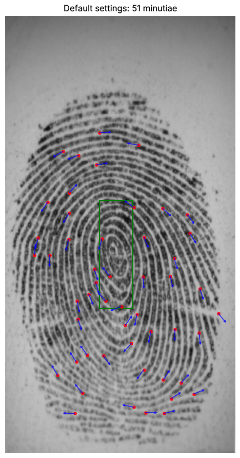

# Minutiae Extractor

This repository finds the minutiae of a fingerprint image: the points where a ridge ends
or splits, each with a position and a direction. It is a port of MinutiaeNet (the networks
CoarseNet and FineNet) to Keras 3 and TensorFlow, together with ClassifyNet (minutia type)
and CoreNet (core detection) from the FingerFlow project. Its Python package is named
`fingerflow`.

It is a fork of [tourmii/minutiae_extractor](https://github.com/tourmii/minutiae_extractor).
The fork adds a correction of the minutia direction (`direction_confidence` column), two
opt-in options that find more minutiae (`crop_to_print`, `reweight_score`), the choice to
leave out ClassifyNet and CoreNet, and fixes to the patch location and image handling.
The upstream repository has none of this, and neither has the `fingerflow` package on
PyPI, which is the original FingerFlow release. Do not `pip install fingerflow`; install
from this repository as described below.



*The sample image of this repository with the minutiae the default settings return.*

## Where this fits

The main use here is to prepare minutiae for training DeepPrint, a network that turns a
fingerprint into a fixed-length vector. That work is spread over two repositories:

| Step | Where |
|---|---|
| 1. Collect the images and their resolution | [fixed-length-fingerprint-extractors](https://github.com/craig-forefront/fixed-length-fingerprint-extractors) (the "DeepPrint repository") |
| 2. Resample to 500 ppi, invert light-ridge images | DeepPrint repository, done by its `scripts/extract_minutiae.py` |
| 3. Find the minutiae | **this repository**, called by that same script |
| 4. Train DeepPrint, compute embeddings | DeepPrint repository |

If you came here from the DeepPrint guides, you need three things from this repository:
a clone of `main` (commit `420b6e5` or later), the two model files `CoarseNet.h5` and
`FineNet.h5`, and the package importable as `fingerflow`. Follow
[Installation](#installation), check it with the [quick start](#quick-start), then go back
to the DeepPrint guide that sent you here. You do not call the `Extractor` yourself.

## Input images

Read this before the first run; the output is of little use otherwise.

- **500 ppi** (pixels per inch). The networks work at this one scale and nothing in this
  package rescales the image. Resample images of any other resolution first. Prints at
  1000 ppi passed in unchanged gave under 10% of the minutiae an examiner had marked.
- **8-bit** (`uint8`) grayscale, BGR or BGRA array, as `cv2.imread` returns it.
- **Dark ridges on a light background.**

How to resample and invert is in [docs/usage.md](docs/usage.md#preparing-the-image). The
DeepPrint script of step 2 above does both for you.

## Installation

Tested on Linux x86_64 with [uv](https://docs.astral.sh/uv/) 0.11 and Python 3.13 (Python
3.11 or later is required). Other platforms were not tried.

```bash
git clone https://github.com/craig-forefront/minutiae_extractor
cd minutiae_extractor

uv sync                                  # creates .venv and installs the dependencies
uv pip install -e .                      # makes the package importable as "fingerflow"
uv run python scripts/install_model.py   # downloads the model weights into models/
```

If `uv` is not installed: `curl -LsSf https://astral.sh/uv/install.sh | sh` puts it into
`~/.local/bin` (this installer command was not run for this document; uv was already
present).

What to expect:

- `uv sync` installs the exact versions recorded in `uv.lock` (TensorFlow 2.20.0). It
  reported 109 packages installed here; `uv.lock` lists 114, some of them for other
  platforms. The `.venv` directory was 6.4 GB here. 3.9 GB of that are NVIDIA GPU libraries,
  which are installed on a machine without a GPU as well.
- `uv sync` does **not** install the `fingerflow` package itself; the next line does. If
  you run `uv sync` again later, it removes the package again: repeat
  `uv pip install -e .`.
- `scripts/install_model.py` downloads the four weight files (1.6 GB), and a small
  `README.md` with them, from the model repository
  [tourmaline05/MinutiaeNet](https://huggingface.co/tourmaline05/MinutiaeNet) on Hugging
  Face. Check them:

  ```bash
  ls -l models
  ```

  | File | Size | Network | Needed for |
  |---|---|---|---|
  | `CoarseNet.h5` | 81 MB | proposes minutiae | always |
  | `FineNet.h5` | 654 MB | scores each proposed minutia | always |
  | `ClassifyNet_6_classes.h5` | 619 MB | minutia type | only for the `class` column |
  | `CoreNet.weights` | 256 MB | core detection | only for the `core` result |

  `models/` is listed in `.gitignore`; the weights are not part of the repository.

Run Python through `uv run python ...` from the repository directory, or activate the
environment once per shell with `source .venv/bin/activate`.

For a machine without internet access see
[AIR_GAPPED_DEPLOYMENT_GUIDE.md](AIR_GAPPED_DEPLOYMENT_GUIDE.md).

## Quick start

Save this as `quickstart.py` in the repository directory (`.gitignore` lists that file
name, so git does not report it):

```python
import cv2
from fingerflow.extractor import Extractor

extractor = Extractor("models/CoarseNet.h5", "models/FineNet.h5",
                      "models/ClassifyNet_6_classes.h5", "models/CoreNet.weights")

image = cv2.imread("sample/sample_fingerprint.tif")
result = extractor.extract_minutiae(image)

minutiae = result["minutiae"]
print(len(minutiae), "minutiae")
print(minutiae.head())
print(result["core"])
```

```bash
uv run python quickstart.py
```

After many TensorFlow log lines (including a message that no CUDA device was found, on a
machine without a GPU) it prints, for the sample image:

```
51 minutiae
       x      y     angle     score  class  direction_confidence
0  121.0  149.0  6.239221  0.998402    1.0              0.695495
1  169.0  382.0  1.752636  0.998863    0.0              0.665957
2  177.0  334.0  1.507795  0.998872    0.0              1.057563
3  217.0  310.0  1.286846  0.997997    1.0              0.920657
4  124.0  285.0  1.837194  0.995029    1.0              0.565101
    x1   y1   x2   y2     score   w    h
0  121  236  164  374  0.966214  43  138
```

The whole run took a little over a minute on 4 CPU cores and no GPU.

**With two networks only.** ClassifyNet and CoreNet are optional. This is what the
DeepPrint script uses, and it is faster:

```python
extractor = Extractor("models/CoarseNet.h5", "models/FineNet.h5", None, None)
```

The `class` column is then `NaN` and `result["core"]` is `None`.

The notebook [demo.ipynb](demo.ipynb) does the same and draws the minutiae on the image.

## Output

`extract_minutiae` returns a dictionary with two entries.

`result["minutiae"]` is a pandas DataFrame with one row per minutia:

| Column | Meaning |
|---|---|
| `x`, `y` | Position in px: `x` is the column, `y` the row (pointing down) |
| `angle` | Direction in radians, 0 to 2π; the direction vector is `(cos(angle), sin(angle))` |
| `score` | Confidence of the detection, 0 to 1. Its meaning changes with `reweight_score` |
| `class` | Minutia type: `0` ending, `1` bifurcation, `2` fragment, `3` enclosure, `4` crossbar, `5` other. `NaN` without ClassifyNet |
| `direction_confidence` | How clear the direction was; 0.25 or more is reliable. Absent with `refine_direction=False` |

`result["core"]` is a DataFrame with the columns `x1`, `y1`, `x2`, `y2`, `score`, `w`, `h`
(one row per detected core box), or `None` without CoreNet. Check for `None` before you
use it:

```python
cores = result["core"]
if cores is not None and len(cores) > 0:
    best = cores.loc[cores["score"].idxmax()]
    print(f"Core box from ({best['x1']}, {best['y1']}) to ({best['x2']}, {best['y2']})")
```

The full description of every column is in [docs/usage.md](docs/usage.md#reference).

## Options at a glance

All are arguments of `Extractor(...)`; each links to its explanation.

| Option | Default | What it does |
|---|---|---|
| [`refine_direction`](docs/usage.md#direction-sense) | `True` | Takes the direction of each minutia from the ridge pattern, because the direction CoarseNet reports is unreliable |
| [`image_dpi`](docs/usage.md#direction-sense) | `500` | Scale of the direction step only. It does not rescale the image. Leave it at 500 |
| [`crop_to_print`](docs/usage.md#finding-more-minutiae) | `False` | Runs the networks on the print area only, which helps on images with a large empty margin |
| [`reweight_score`](docs/usage.md#finding-more-minutiae) | `False` | Finds more minutiae; changes the meaning of `score`, and an image can come back empty |
| [`classify_net_path=None`, `core_net_path=None`](docs/usage.md#leaving-out-classifynet-and-corenet) | paths required | Leaves out the minutia type and the core detection |

## What to expect

These figures come from prints of the public NIST SD 302 collection whose minutiae a
fingerprint examiner had marked, at 500 ppi, on a machine without a GPU. Samples, tables
and limits are in [docs/measurements.md](docs/measurements.md).

- **Not every minutia is found.** With the default settings the extractor found 42% of
  the examiner-marked minutiae on 130 rolled and slap prints, and 77% of what it reported
  had an examiner mark. With `crop_to_print` and `reweight_score` together: 50% and 82%.
  On latent prints (prints left on a surface) it found 29%.
- **The direction is right for most minutiae it finds:** 96.6% on rolled and slap prints,
  91.8% on latents.
- **It is slow on a CPU.** Roughly 20 to 80 seconds per print, depending on the size of
  the print, the number of minutiae and the networks loaded.
- **Not measured:** speed or operation on a GPU; throughput on more than a few hundred
  prints; other sensors than the five of that collection; how often the minutia type is
  right; how well the core is found; the effect of any option on a DeepPrint model.

## Documentation

| Document | What it is for |
|---|---|
| This README | What the repository is, installation, first run |
| [docs/usage.md](docs/usage.md) | How to prepare images, what each option does and when to use it, use with DeepPrint, reference of parameters and columns |
| [docs/measurements.md](docs/measurements.md) | Every measured figure with its sample, and what was not measured |
| [AIR_GAPPED_DEPLOYMENT_GUIDE.md](AIR_GAPPED_DEPLOYMENT_GUIDE.md) | Installation on a machine without internet access |
| [demo.ipynb](demo.ipynb) | Notebook: run the extractor on the sample image and draw the result |
| [DeepPrint repository](https://github.com/craig-forefront/fixed-length-fingerprint-extractors) | Extraction over a directory of images (`scripts/extract_minutiae.py`) and DeepPrint training |

## Running the tests

`uv sync` does not install pytest. From the repository directory:

```bash
uv run --with pytest python -m pytest -q
```

This runs the 79 unit tests in `test/`. They need no model files and no GPU. The tests
import the package as `src.fingerflow`, so they only work when started in the repository
directory.

## Repository layout

```
minutiae_extractor/
├── README.md                        this file
├── AIR_GAPPED_DEPLOYMENT_GUIDE.md   offline installation
├── docs/
│   ├── usage.md                     options and reference
│   └── measurements.md              measured figures and limits
├── demo.ipynb                       notebook on the sample image
├── assets/                          figure used in this README
├── sample/sample_fingerprint.tif    sample image
├── src/fingerflow/
│   ├── extractor/                   the Extractor (maintained)
│   └── matcher/                     VerifyNet matcher of FingerFlow (not maintained)
├── scripts/
│   ├── install_model.py             downloads the weights
│   └── legacy/                      old FingerFlow scripts (not maintained)
├── test/                            unit tests
├── pyproject.toml, uv.lock          dependencies and their locked versions
├── .devcontainer/                   container definition for VS Code (not tried for this port; asks for a GPU)
├── minutiae_patches/                image patches written by an old notebook run
└── models/                          the weights; appears after the download, not in git
```

Not maintained means: carried over from the original FingerFlow project, not run or
tested for this port. For the matcher (`src/fingerflow/matcher`) no weights are
downloaded. The scripts in `scripts/legacy/` have hard-coded paths of another machine;
see [scripts/legacy/README.md](scripts/legacy/README.md).

## Licence and citation

- **Licence.** This repository contains no licence file. Earlier versions of this README
  named the MIT licence. The model card of the weights on Hugging Face
  ([tourmaline05/MinutiaeNet](https://huggingface.co/tourmaline05/MinutiaeNet)) declares
  Apache-2.0. Ask the repository owner before you redistribute code or weights.
- **Citation.** The networks CoarseNet and FineNet are from: Dinh-Luan Nguyen, Kai Cao
  and Anil K. Jain, "Robust Minutiae Extractor: Integrating Deep Networks and Fingerprint
  Domain Knowledge", International Conference on Biometrics 2018,
  https://arxiv.org/pdf/1712.09401.
- **Origin of the code.** ClassifyNet, CoreNet and the structure of the package come from
  the FingerFlow project (https://github.com/jakubarendac/fingerflow).
